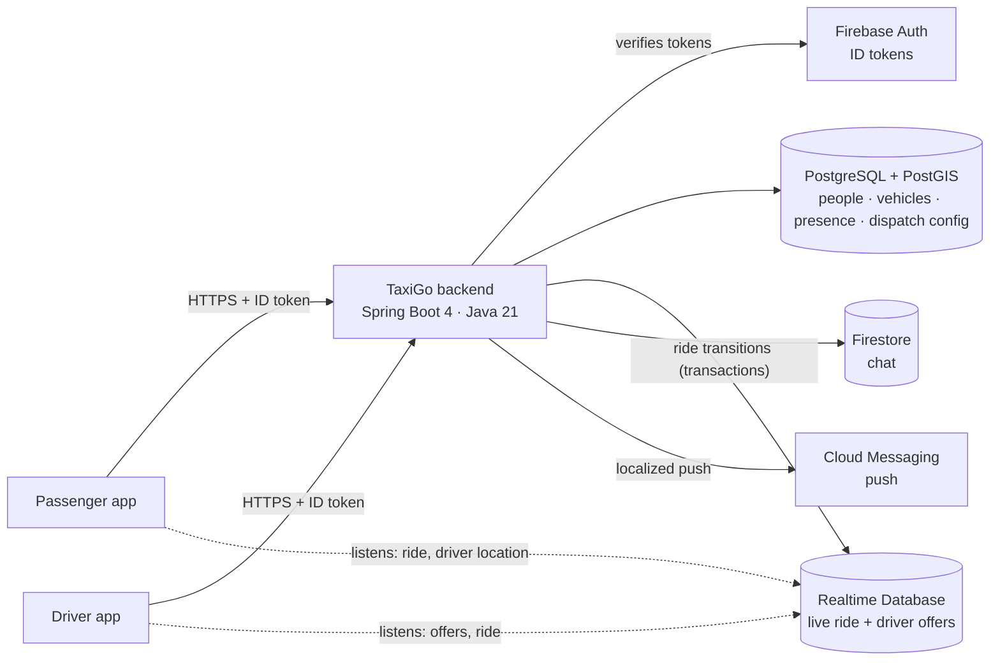

<div align="center">

# TaxiGo Backend

**The Spring Boot API behind TaxiGo — a real-time taxi dispatch platform built for the city of Riobamba, Ecuador.**

[]()
[]()
[]()
[]()
[]()
[](https://github.com/areascript22/taxi-backend/actions/workflows/ci.yml)

[Overview](#-overview) • [What it does](#-what-it-does) • [Architecture](#-architecture) • [Data](#-where-the-data-lives) • [Dispatch](#-dispatch-by-rings) • [Security](#-security) • [Run it](#-getting-started) • [Tests](#-testing) • [CI/CD](#-cicd) • [Docs](#-further-reading)

</div>

---

## 📖 Overview

TaxiGo is made of three pieces. This repository is the one in the middle:

| Piece | Repository | Role |
|---|---|---|
| **TaxiGo** (passenger app) | [`project-taxi-passenger`](https://github.com/areascript22/project-taxi-passenger) | Riders request a taxi and follow it live |
| **TaxiGo Driver** | [`project-taxi-driver`](https://github.com/areascript22/project-taxi-driver) | Drivers go online, receive offers and run the trip |
| **TaxiGo backend** (this repo) | `taxi-backend` | Owns people, dispatch and every ride-state transition |

The apps never decide anything that matters. Who may accept a ride, which drivers get an offer, whether a driver is approved, how a ride moves from *pending* to *completed* — all of it is decided here, so that two drivers can never take the same ride and a modified client cannot skip a rule.



## ✨ What it does

| Feature | Responsibility | Main endpoints |
|---|---|---|
| **`ride`** | Ride lifecycle: request, accept, arrive, start, cancel, complete, expire, query the active ride | `POST /api/rides/request` · `POST /api/rides/{passengerId}/{accept,arrived,start,cancel,complete}` · `GET /api/rides/{passenger,driver}/active` |
| **`dispatch`** | Driver presence (online, busy, where) and the **ring-based offering** of each request to nearby drivers | `PUT /api/me/driver/availability` · `PUT /api/me/driver/location` |
| **`user`** | Who a person is, their role and their driver/passenger profiles (with vehicle) | `GET /api/me` · `PUT /api/me/driver-profile` · `PUT /api/me/passenger-profile` · `PUT /api/me/device` |
| **`driveradmin`** | Admin panel: list, approve/reject, block/unblock, change role, delete drivers | `GET /api/drivers` · `PUT /api/drivers/{uid}/{role,approval-status,block-status}` · `DELETE /api/drivers/{uid}` |
| **`chat`** | Messages between passenger and driver during a ride | `POST /api/rides/{passengerId}/messages` |
| **`account`** | A user deleting their own account | `DELETE /api/account` |
| **`appversion`** | Minimum supported version per app (forced-update gate) | `GET /api/public/app-version` *(public)* |
| **`notification`** | Builds and sends push notifications in the **recipient's** language | — |
| **`identity`** | The authentication account (roles, deletion) | — |
| **`common`** | Errors, configuration, security, Firebase | — |

Background jobs expire requests nobody answered and clean up finished rides. A bootstrap step guarantees the project owner ("founder") always has superuser rights and is auto-approved as a driver.

## 🏗️ Architecture

**One package per feature, four layers inside each**, with dependencies pointing only inward:

```
com.areascript.taxiapp
 ├─ ride/ · dispatch/ · user/ · driveradmin/ · chat/ · account/ · appversion/
 │    ├─ api/          controllers and request/response records (HTTP)
 │    ├─ application/  use cases: coordinate rules and ports
 │    ├─ domain/       model, rules and PORTS (interfaces). Pure Java.
 │    └─ infra/        implementations of the ports (Postgres, Firebase)
 ├─ notification/ · identity/ · bootstrap/
 └─ common/            error · config · firebase · security
```

```
        api ──▶ application ──▶ domain ◀── infra
```

- **`domain`** knows nobody: no Spring, no Firebase, no servlets. Business rules are **pure functions** (`RideTransitions.cancel(ride, caller)`) so they can be replayed atomically inside a database transaction.
- **`application`** orchestrates use cases through ports and never touches the Firebase SDK.
- **`infra`** is the only layer that uses Firebase or JPA; it implements the domain's ports (dependency inversion).
- **Features only know each other's `domain`.** When one needs another, the other exposes a port (`UserNotifier`, `ActiveRideLookup`…). When one *reacts* to another, a domain event is used (`RideRequested`, `RideAccepted`, `NoDriversAvailable`…).

These rules are **enforced by the build**: `ArchitectureRulesTest` (ArchUnit) fails if `domain` imports Spring or Firebase, if a feature reaches into another's `infra`, if a controller touches a database, and so on.

Errors are a small closed set (`InvalidInput` 400 · `Forbidden` 403 · `NotFound` 404 · `Conflict` 409 · `ExternalService` 500) translated in **one** place, `GlobalExceptionHandler`, to `application/problem+json` (RFC 9457). Controllers have no `try/catch`.

## 🗄️ Where the data lives

| Data | Store | Written by |
|---|---|---|
| People (`users`), driver/passenger profiles, vehicles, roles | **PostgreSQL** | The server only |
| Driver presence and last location (`driver_locations`, PostGIS `geography(Point)` + GiST index) | **PostgreSQL / PostGIS** | The server (location arrives over HTTP) |
| Dispatch settings and rings (editable without a deploy) | **PostgreSQL** | An admin |
| The ride in progress `taxi_requests/{passengerId}` and each driver's offer tray `driver_offers/{uid}` | **Realtime Database** | The server only (transactions) |
| Chat | **Firestore** | The server only (TTL of 7 days) |
| Profile photos | **Storage** | The app; the server only accepts the URL of the user's own object |
| Accounts and login | **Firebase Auth** | The apps log in; the server verifies the ID token on every request |

The schema changes **only** through Flyway migrations (`src/main/resources/db/migration`); an applied migration is never edited. Hibernate runs with `ddl-auto=validate`, so an entity that drifts from the schema stops the server from starting.

## 📡 Dispatch by rings

When a passenger requests a ride, the server offers it to the **nearest available drivers**, widening the search in rings:

```
RideRequested ─▶ ring 1: the N closest available drivers within radius 1  ─▶ driver_offers/{uid}/{passengerId}
                 wait a few seconds
              ─▶ ring 2: only the NEW drivers within radius 2             ─▶ ...
              ─▶ no more rings ─▶ NoDriversAvailable ─▶ the ride is closed by `ride`
RideAccepted / RideRequestWithdrawn ─▶ every offer is withdrawn, the search ends
```

*Available* means **online AND not on a ride AND a location fresher than the configured age**, found with a PostGIS `ST_DWithin` query. The offer tray is the evidence: a driver can only accept a ride they were actually offered. Rides are accepted inside a Realtime Database **transaction**, so if two drivers tap at once exactly one wins and the other gets a `409`. A retry from the driver who already owns the ride is treated as success (idempotent), so a slow response never ends in a spurious error.

## 🔐 Security

- **Stateless Spring Security.** Every `/api/**` call needs a Firebase **ID token**, except `/api/public/**` (the version gate the apps call before login).
- **The token proves WHO; the database says WHAT they can do.** Authorities come from `users.role_code` (`user` < `admin` < `superuser`), not from token claims, so a role change applies on the next request and a forged claim opens nothing. If the database is down the filter answers `503` instead of trusting the token.
- **Identity always comes from the token**, never from a body, header or path.
- A role-hierarchy policy decides who may moderate whom (nobody can act on a superuser through the API).
- **Secrets are never versioned** (`secrets/` is git-ignored); configuration comes from environment variables.

## 🚀 Getting started

**Requirements:** JDK 21, Docker, a Firebase project with a service-account key.

```bash
# 1. Postgres + PostGIS on 127.0.0.1:5442 (the DB never publishes a port in production)
docker compose -f compose.yaml -f compose.dev.yaml up -d db

# 2. Secrets (not in the repo): put the Firebase service-account key under secrets/
#    and configure the environment — see .env.example and secrets/*.properties

# 3. Run, from this folder (default credential paths are relative)
./mvnw spring-boot:run
```

Configuration lives in `application.properties` with profile overrides (`dev`, `staging`, `prod`) and environment variables for everything deployment-specific: Firebase credentials and URLs, the founder account, the minimum version per app, and the dispatch switches. The full table is in [`ARCHITECTURE.md`](ARCHITECTURE.md#7-configuración).

The full stack (database + server, exactly as it runs in production) is `docker compose up -d`.

## ✅ Testing

```bash
./mvnw test     # needs JDK 21 (and Docker for the Postgres tests)
```

| Kind | What it protects |
|---|---|
| **Characterization** | The HTTP behaviour of the endpoints, against the real server with Firebase replaced by in-memory fakes that run the real transactions. They are the safety net for every refactor. |
| **Domain / application** | Pure rules and use cases with in-memory ports — no Spring, no Firebase. |
| **Infrastructure** | Mapping and message building; Postgres adapters run on **Testcontainers** (skipped automatically without Docker). |
| **Architecture** | The dependency rules above (ArchUnit). |

Every change ships with its test, and tests are checked by breaking the rule on purpose and watching them fail.

## 🔄 CI/CD

| Trigger | Workflow | What happens |
|---|---|---|
| Pull request to `dev` / `qa` | [`ci.yml`](.github/workflows/ci.yml) | Runs the test suite on JDK 21 |
| Push to `qa` | [`build-qa.yml`](.github/workflows/build-qa.yml) | Tests, builds the Docker image and publishes it to GHCR (`:<sha>` immutable and `:qa`). It deploys nothing: staging is a VM deployed by hand with that exact image |
| Push to `main` | [`deploy-prod.yml`](.github/workflows/deploy-prod.yml) | Deploys **the same image that was built and tested on `qa`** to the production droplet over SSH, health-checks it from outside, and rolls back automatically if the new image does not respond. Rollback or redeploy of any older image: *Actions → Run workflow* with its sha |

Flow: `dev` → PR → `qa` (image built) → PR with **"Create a merge commit"** → `main` (production). A squash merge into `main` is rejected on purpose, because it would not match any published image.

Production runs Postgres and the server as two containers behind Caddy (automatic TLS) on one small droplet, with memory limits so one cannot starve the other, a daily `pg_dump` and a script that pulls backups off the machine.

## 📚 Further reading

- [`ARCHITECTURE.md`](ARCHITECTURE.md) — how it is built and why: layers, cross-feature ports, data stores, request walk-through, security, configuration, the Postgres migration and known limits.
- [`CLAUDE.md`](CLAUDE.md) — the coding rules and the test policy for this project.
- [`ops/README.md`](ops/README.md) — database operations, backups and restore. [`ops/DEPLOY.md`](ops/DEPLOY.md) and [`ops/STAGING.md`](ops/STAGING.md) — deployment runbooks.

---

<div align="center">

Built and maintained by **[@areascript22](https://github.com/areascript22)**.

</div>
